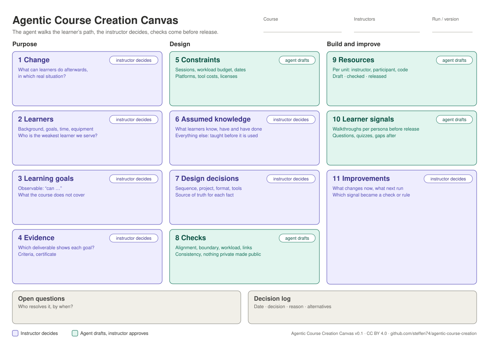

# Agentic Course Creation

A canvas, a process and a set of agent skills for designing, building and improving a course with a coding agent, without handing over the teaching judgement.

> Status: **v0.1, draft.** A companion to [Agentic Data Science](https://github.com/steffen74/agentic-data-science), built while running the opencampus.sh course “Introduction to Data Science and Machine Learning”. Same canvas grammar, same skill conventions.

## Why

Coding agents make course material cheap to produce: session plans, participant pages, notebooks, quizzes, all in an afternoon. What they do not make cheap is the part that decides whether learners can actually learn from it:

- knowing what the learners already know, have and can do, and what they do not,
- noticing that a task refers to a repository nobody told them to create,
- keeping ten pages in three repositories consistent with each other,
- learning from what went wrong in session 1 before session 2.

An agent left to guess produces plausible material. A missing setup step looks fine to everyone who already knows the step. Learners find it the evening before the deadline.

This repository encodes a different habit: **the agent finds facts and walks the learner’s path, the instructor decides, and material passes explicit checks before learners see it.**

## The three parts

### 1. The canvas

The [Agentic Course Creation Canvas](canvas/) is one page with eleven blocks plus a log, in three columns: **Purpose**, **Design**, **Build and improve**. Each block has an owner:

- **Instructor decides**: change, learners, learning goals, evidence, assumed knowledge, design decisions, improvements.
- **Agent drafts, instructor approves**: constraints, checks, resources, learner signals.

In a course repository the canvas lives as `COURSE-CANVAS.md`. A printable version is in [`canvas/`](canvas/).

[](canvas/agentic-course-creation-canvas.pdf)

### 2. The process

```
purpose ──► resources ──► plan ──► draft unit ──► quiz, slides ──► walk through ──► review ──► release
   ▲                                    ▲                                                │
   │                                    └─────────────────── fix ◄──── signals ◄──── run ┤
   └──────────────── retro: checks, boundary, personas, skill rules ◄────────────────────┘
```

Each step ends at a **stop point** where the instructor decides. See [docs/process.md](docs/process.md) and the [principles](docs/principles.md).

### 3. The skills

Plain-text agent skills (`SKILL.md`) for Claude Code, GitHub Copilot, Cursor, Codex and other agents that support skills.

| Skill | Use it to | Canvas blocks |
|---|---|---|
| `/setup-course` | Set up the course repository once: canvas, personas, resource map, decision log, signals, checks | all |
| `/ask-course` | Find out which skill fits your situation | – |
| `/show-canvas` | See the canvas as a page in the browser, with empty blocks and stale blocks marked; `live` keeps it updating | all |
| `/grill-course` | Get interviewed until change, learners, goals, evidence and assumed knowledge are sharp | 1–4, 6 |
| `/map-resources` | Inventory every repository and platform: who sees what, source of truth, conflicts, leaks | 5, 9 |
| `/to-course-plan` | Unit plan with alignment matrix, growth of assumed knowledge and workload | 3, 4, 6, 7 |
| `/draft-unit` | Draft one unit, writing the learner’s path before the content | 7, 9 |
| `/to-quiz` | Write a unit’s quiz into the course’s quiz source and create it in Microsoft Forms, Formbricks or another tool | 4, 9 |
| `/to-slides` | Build a unit’s slides from its approved session plan, in your slide format | 9 |
| `/walk-through` | Walk a unit as each learner persona and report every step they could not take | 6, 8, 10 |
| `/review-unit` | Review a unit on two axes, alignment and learner, then release, fix or hold | 8, 9 |
| `/course-retro` | Turn what happened in class into fixes, checks, boundary entries and skill improvements | 10, 11 |

Reference skills used by the others: `assumed-knowledge`, `course-checks`, `learner-instructions`.

## The skill that would have caught it

The most common gap is not a concept but a step nobody wrote down. A homework asks learners to work in “your copy of the template repository”, but no page tells them to make one. Everyone who wrote the material knows the step, so nobody sees that it is missing.

`/walk-through`, run as an agent that sees only the participant pages and knows only what a persona knows, reports such a step as a **blocker**, together with the less obvious ones: a tool that needs software nobody installed, a video listed after the task that needs it, a task that does not say where to work.

## Install

```bash
# Editable copies in your course repository (any agent; needs Node.js 22.20 or newer)
npx skills@latest add steffen74/agentic-course-creation

# Claude Code plugin
claude plugin marketplace add steffen74/agentic-course-creation
claude plugin install agentic-course-creation@agentic-course-creation
```

Then, once per course: `/setup-course`.

## Quickstart for a course that already runs

1. `/setup-course`, listing every repository and platform the course uses.
2. `/map-resources`: find conflicts and leaks between them.
3. `/grill-course`: at least block 6 (assumed knowledge) and the weakest persona.
4. `/walk-through <next unit>` before every release; `/review-unit` to fix and release.
5. `/course-retro` after every session.

## Works well with

- [Agentic Data Science](https://github.com/steffen74/agentic-data-science) for the subject content of data science courses: course skills design the learning path, data science skills check the analyses inside it.
- Matt Pocock’s `writing-for-agents` when editing skills, and `grilling` when stress-testing a design decision.

## Credits and licenses

- Skills: [MIT](LICENSE). Several skills follow the structure of [Matt Pocock’s skills](https://github.com/mattpocock/skills) (MIT); see [NOTICE.md](NOTICE.md).
- Canvas and documentation: [CC BY 4.0](LICENSE-docs.md).
- Ideas from backward design (Wiggins and McTighe), constructive alignment (Biggs) and research on simulated learners; see [docs/principles.md](docs/principles.md#related-work).
