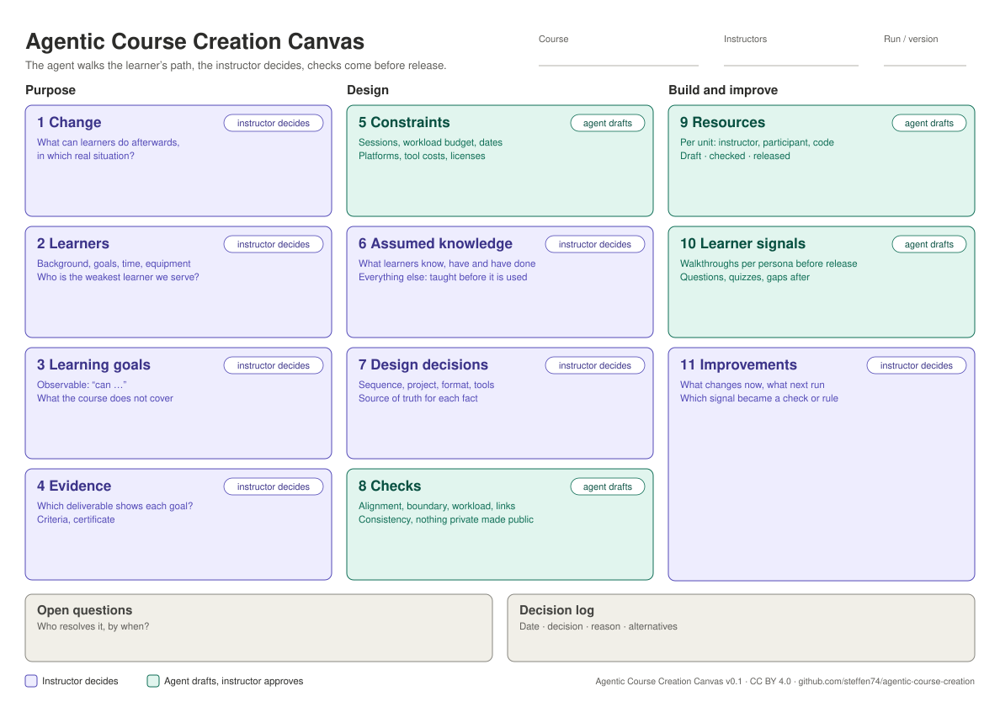

# The Agentic Course Creation Canvas

One page, eleven blocks, one log. Fill it from left to right the first time, then revisit any block when something changes. It mirrors the [Agentic Data Science Canvas](https://github.com/steffen74/agentic-data-science/tree/main/canvas) block by block, so learners and instructors can use one grammar for both.

- Markdown template for courses: [`COURSE-CANVAS.md`](../skills/setup-course/templates/COURSE-CANVAS.md) (copied into your repository by `/setup-course`)

**Owners.** 👤 *Instructor decides*: the agent may recommend, but the instructor makes and signs the decision. 🤖 *Agent drafts, instructor approves*: the agent does the legwork; the instructor checks and accepts it.

| Data science canvas | Course creation canvas | Shared idea |
|---|---|---|
| 1 Decision | 1 Change | Start from what should be different in the world |
| 2 Questions | 3 Learning goals | Turn it into something you can work towards |
| 3 Audiences | 2 Learners | Know who receives the result |
| 4 Success | 4 Evidence | Fix in advance what counts |
| 5 Data | 5 Constraints | Factual inventory, agent’s job |
| 6 Known in advance | 6 Assumed knowledge | **The boundary**: everything outside it is leakage / a gap |
| 7 Data decisions | 7 Design decisions | Judgement calls, logged |
| 8 Checks | 8 Checks | Invariants before anything counts |
| 9 Experiments | 9 Resources | What was built |
| 10 Findings | 10 Learner signals | What it showed |
| 11 Recommendation | 11 Improvements | Close the loop |

---

## Purpose

### 1. Change 👤
**Purpose:** anchor the course in what learners should be able to do afterwards, in a real situation.
**Prompts:** What can learners do after the course that they could not before? In which situation will they use it? Why this course, for whom, now?
**Typical mistakes:** starting from the topic list (“we cover pandas, Git, neural networks”) instead of the change; a change no single course could make.
**Filled by:** `/grill-course`

### 2. Learners 👤
**Purpose:** design for the people who actually come.
**Prompts:** Background, goals, time per week they really have, equipment and rights, language, what they pay for. Who is the weakest learner the course still wants to serve?
**Typical mistakes:** designing for the instructor’s former self; one “average” learner; no idea about equipment (laptop without admin rights, Chromebook).
**Filled by:** `/grill-course`; details in `PERSONAS.md`

### 3. Learning goals 👤
**Purpose:** say what learners can do, observably.
**Prompts:** Which few goals at course level? What does “can” look like for each? What does the course deliberately not cover?
**Typical mistakes:** goals that are activities (“work with Git”) instead of abilities; too many goals; nothing explicitly excluded.
**Filled by:** `/grill-course`, `/to-course-plan`

### 4. Evidence 👤
**Purpose:** decide in advance how learners and instructors know a goal is reached.
**Prompts:** Which deliverable or observation shows each goal? What is the criterion? What is required for a certificate?
**Typical mistakes:** goals without evidence; deliverables that serve no goal; criteria invented at grading time.
**Filled by:** `/grill-course`, `/to-course-plan`

---

## Design

### 5. Constraints 🤖
**Purpose:** a factual inventory of what the design must fit into.
**Prompts:** Number and length of sessions, and what a unit is (week, day, module), the handbook, quiz tool and slide format (and whether a connector exists for them), credits and workload budget, dates, format, platforms, tools and their cost per plan, existing material, licenses of data and videos.
**Typical mistakes:** workload estimated instead of computed; a tool that is free only up to a limit learners hit in the project weeks; data with unclear license in public material.
**Filled by:** `/map-resources`

### 6. Assumed knowledge 👤
**Purpose:** draw the prerequisite boundary.
**Prompts:** What does every learner know, have and can do at the start: concepts, accounts, installed software, rights, repositories, conventions? For everything else: where is it taught or provided, before it is used?
**Typical mistakes:** only thinking about concepts and forgetting things learners must *have done* (“your clone of …”); assuming what the instructor’s own setup has; a task that uses a concept from a later unit.
**Filled by:** `/grill-course`; enforced by the `assumed-knowledge` skill and `/walk-through`

### 7. Design decisions 👤
**Purpose:** make every structural choice explicit.
**Prompts:** Sequence of topics, project or case, format (flipped, lecture, project), tools, where each kind of resource lives and which copy is the source of truth.
**Typical mistakes:** decisions only visible in the material; the same fact maintained by hand in three places.
**Filled by:** `/to-course-plan`, `/map-resources` propose; instructor decides; logged in `DECISIONS.md`

### 8. Checks 🤖
**Purpose:** invariants that must hold before material reaches learners.
**Prompts:** Alignment, boundary (walkthrough per persona), workload, consistency across locations, no instructor content in public, links, setup from scratch. Where does each expected value come from?
**Typical mistakes:** reading the material yourself as the check (you know what is missing, so you do not see it); checking only the unit that changed.
**Filled by:** `/to-course-plan`, `/course-retro`; rules in the `course-checks` skill

---

## Build and improve

### 9. Resources 🤖
**Purpose:** a visible map of what exists, for whom, where, in which state.
**Prompts:** Per unit: instructor plan, participant page, slides (and their PDF in the handbook), quiz (source and tool), template or code. Status: draft, checked, released.
**Typical mistakes:** a participant page that refers to a notebook that only exists locally; released without a walkthrough.
**Filled by:** `/map-resources`, `/draft-unit`, `/to-quiz`, `/to-slides`, `/review-unit`

### 10. Learner signals 🤖
**Purpose:** what the material actually did for learners.
**Prompts:** Walkthrough findings before release; repeated questions, missing deliverables, quiz results and feedback after. Which signals are open?
**Typical mistakes:** remembering the problems instead of writing them down; one loud learner treated as the cohort.
**Filled by:** `/walk-through`, `/course-retro`; log in `SIGNALS.md`

### 11. Improvements 👤
**Purpose:** close the loop, now and for the next run.
**Prompts:** What changes before the next session? What changes for the next run? Which signal became a check, a boundary entry, a persona or a skill rule?
**Typical mistakes:** fixing the page but not the reason it slipped through; improvements that live only in the instructor’s head.
**Filled by:** `/course-retro` drafts; the instructor decides

---

## Open questions and decision log

Open questions name who resolves them, by when. Decisions go to `DECISIONS.md` with date, reason and alternatives.
